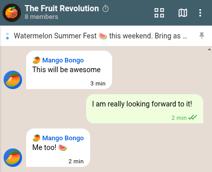
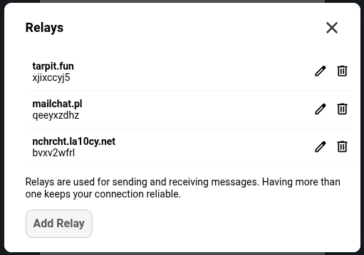
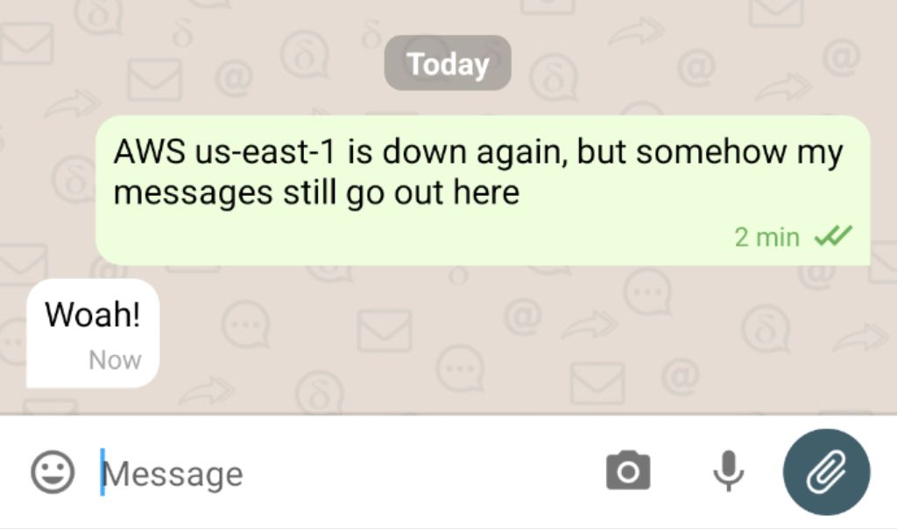
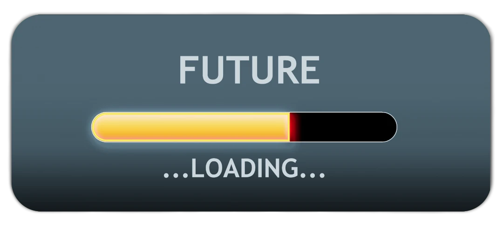

Delivery time! Delta Chat has always been decentralized,
and the latest releases take this even further,
along with improvements in resilience and everyday usability.

New users are now spread across multiple independent relays by default,
we've added Post-Quantum Cryptography support.
But let's start with a long awaited feature:

## Pinned Messages are here

**Keep important information** right at hand.
You can now pin relevant or frequently needed messages to the top of your chats.
This makes it easy to find group rules,
important announcements or quickly **access mini-apps** that are used often,
without endless scrolling.

## More decentralized, but just as simple

The moment we introduced nine.testrun.org as default onboarding [relay](/help#relays),
we already knew that we would work towards removing it.
It should not become a central point of failure.
At the same time, we could not just onboard users to a random single relay
because if it goes down then its users would be left unable to communicate.

Today we've finally reached a milestone:

**New profiles are automatically distributed across multiple independent relays.**
This ensures no single point of failure
and keeps the network truly decentralized.
For the users, however, the onboarding experience is just **as simple as before.**

## Improved Resilience: Relay auto-fallback

If one of your relays fails on sending a message,
Delta Chat automatically falls back to another,
ensuring your **messages always get through.**

If you add or remove relays,
your contacts follow these changes automatically,
so that **messages will always reach you** seamlessly.

To be clear: Most user do not need to change relays manually,
and in the future we aim to detect and replace broken relays automatically.

<!-- original image source: https://www.publicdomainpictures.net/en/view-image.php?image=221604&picture=future-downloading -->

## Preparations for a Post-Quantum Future

Delta Chat now supports Post-Quantum Cryptography (PQC).
While PQC keys are not used by default yet,
this preparation step ensures forward compatibility to future versions of Delta Chat 
without incompatibility issues.

## End-to-end encrypted, always

Speaking of the future:
with upcoming releases,
Users will have the guarantee,
that everything sent or received is encrypted,
without exception.

If you still use Delta Chat for unencrypted messages with classic email addresses,
now is a good time to move to a dedicated email app
such as Thunderbird, FairEmail or K-9 Mail.

Signal took a similar step in 2022 by
[dropping plain-text SMS support](https://signal.org/blog/sms-removal-android/),
and we share most of their reasoning.

## Forgotten Gems

<!-- original image source: https://www.pexels.com/photo/person-holding-gemstones-7965819/ -->

Some of the features listed here actually landed before 2.64.0 releases.
Honestly, we were so busy working on the next batch of improvements
that they didn't get a chance to shine in this blog.
So let's recap.

### Better Message Info

**XXX: [android|ios] add screenshot**

Checking who has read your message is now much cleaner across all platforms.
The list of contacts is clearly visible,
while advanced debugging information (meant primarily for developers)
has been moved away into the dialog's menu.

### Reactions in channels and nicer reaction details

**XXX: [android] add screenshot of a channel with reactions and the reactions details**

Channels just got more interactive.
You can now react to messages in channels,
allowing to get some feedback from subscribers and making them look more alive.
The reaction details dialog also got polished in the process.

For now just a handful of default reactions are allowed
but the idea is to allow channel owners
to personalize what reactions are allowed in their channel,
stay tuned!

### Delta Chat iOS now has Liquid Glass support

**XXX: add screenshot**

Delta Chat iOS added support for Apple's new Liquid Glass UI language,
looking more integrated in such devices.

### In-app upgrades on Android

**XXX: add screenshot**

If you like to get the Android APK-file directly from us,
without any big tech store in the middle,
we have great news for you!

Now the app will notify you when there is a new release
and smoothly allow you to directly download and install the new version.

Don't worry, this doesn't work by pinging some central server,
instead the information is provided by the chatmail relays you are already connecting to!

### And more!

Some more improvements deserving an honorable mention:

**Mark chat as unread:**
Want to read a chat now but answer later?
We've got you covered with the new "Mark as unread" option
in the chat's context menu in the chat list.

**Mark profile as read:**
On the other end of the spectrum,
the ability to mark a whole profile as read has landed across all platforms!

**Improved image quality:**
To the joy of every family chat out there,
the photos you share now look noticeably sharper and retain more detail.

**Multi-select everywhere:**
Multi-select is now fully supported on all platforms,
including a long-requested implementation for Desktop.

**New Webxdc APIs:**
Mini-apps now have access to the new `webxdc.isAppSender` and `webxdc.isBroadcast` APIs,
enabling smarter and more context-aware app experiences within groups and channels.

## Get the Update

Visit [get.delta.chat](https://get.delta.chat) or your preferred store to grab the update
and try out the new features.
Please [let us know](/contribute#translations-and-bug-reports) if you encounter any problems.

## Final Remarks

Thanks for making it to the end of this post!
If you would like to support our efforts, please consider
[contributing or donating](https://delta.chat/en/contribute),
running a [chatmail relay](https://chatmail.at/relays),
trying out the enjoyable experience of creating [secure mini-apps](https://webxdc.org)
or just leaving us a review in your app store of choice.

♥ **thanks for following and supporting us** ♥
