Announcement time! This blog has been quiet for over half a year,
but we continuously released new app versions throughout.
Please get ready for enough news to fill three separate posts:
new user-visible and often-requested features,
how new profiles use the growing chatmail relay network without anyone choosing one,
and our ongoing security hardening efforts, including the announcement that we are dropping unencrypted email.

## Pinned Messages are here

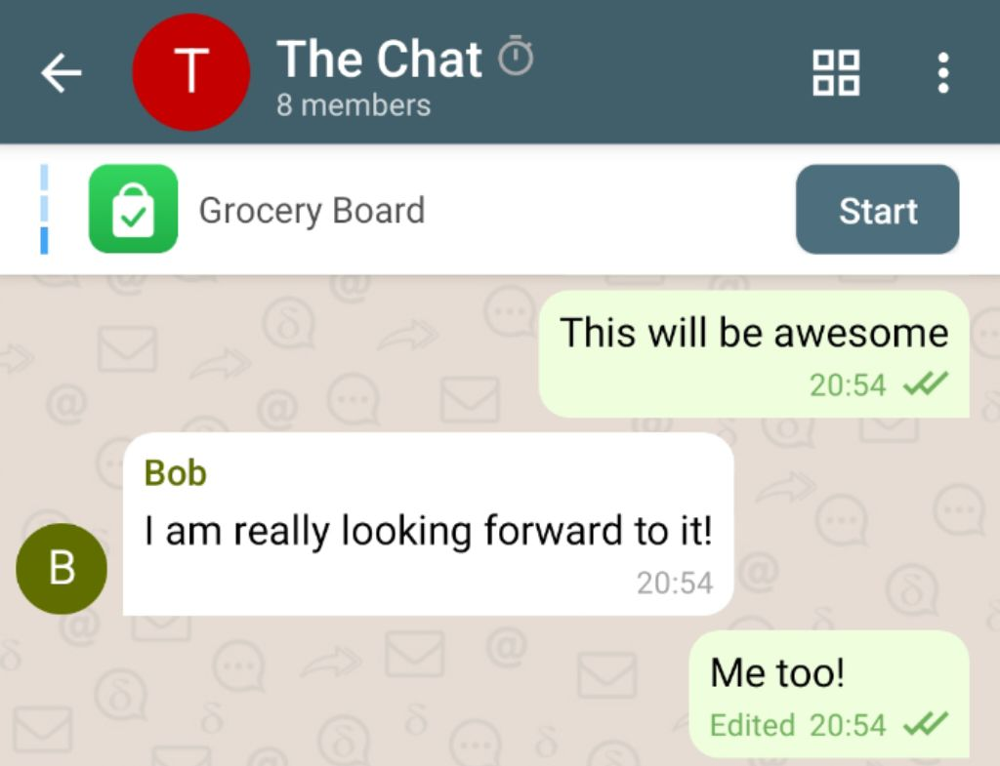
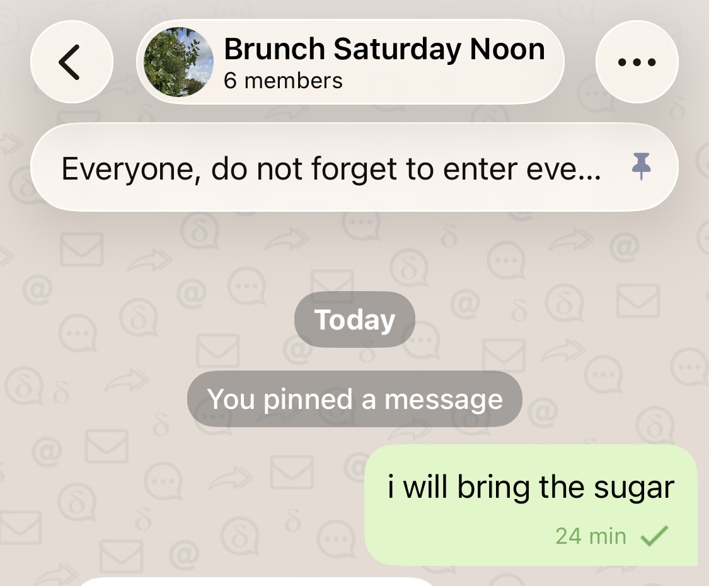

**Keep important information** right at hand.
You can now pin messages to the top of your chats:
important announcements, group guidelines,
or the **mini-apps** you use most, without endless scrolling.

## Delta Chat iOS now has Liquid Glass support

The iOS app now supports Apple's new Liquid Glass design language
and looks much **more integrated.**
Beyond the new controls,
we also took the chance to **renovate** quite a few views and menus.

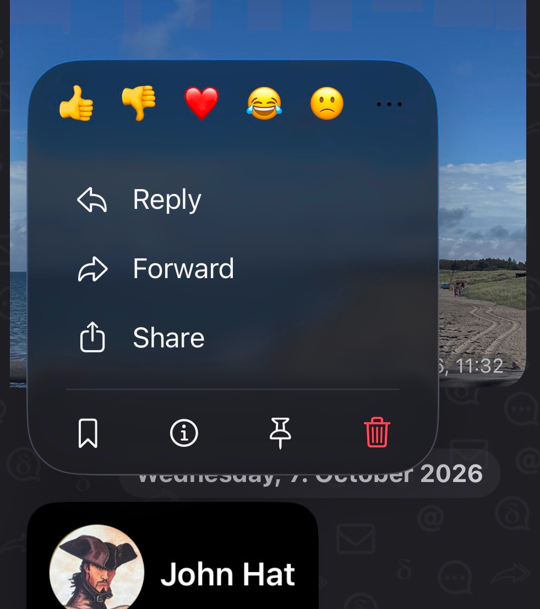
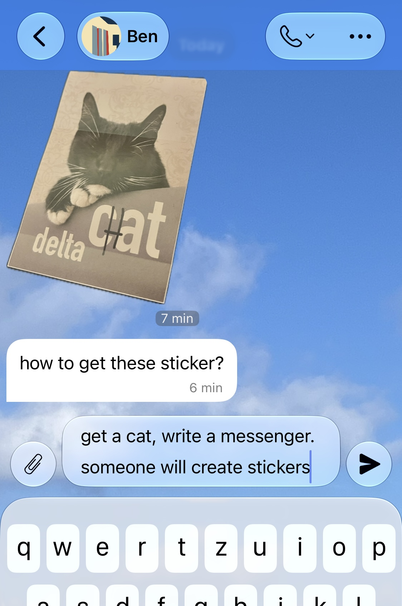

## In-app upgrades on Android

If you [download the Android APK directly from us](https://delta.chat/en/download),
without a big tech store in the middle,
the app now **notifies you about a new release**
and lets you **download and install** it right away.
It learns about new versions from the community chatmail relays it already uses.

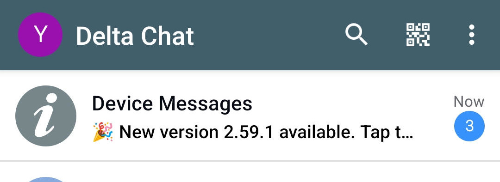
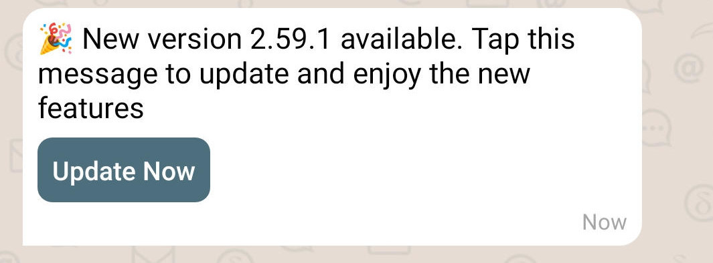

## Reactions in channels and nicer reaction details

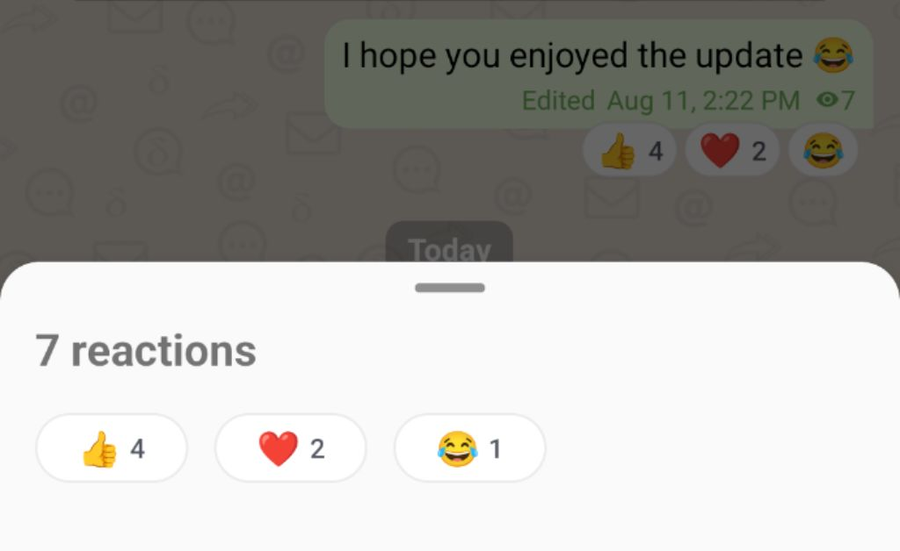

**Channels just got more interactive.**
Reactions now work in channels,
so subscribers are no longer a silent audience and owners can see what resonates.
The reaction details dialog also got polished in the process.

For now there is a small set of default reactions,
and we plan to let channel owners choose which reactions their channel allows.
Stay tuned!

## Better Message Info

Checking **who has read your message** and **when** now looks much nicer on all platforms.
The list of contacts is clearly visible,
while debugging information meant mostly for us developers
has moved into the dialog's menu.

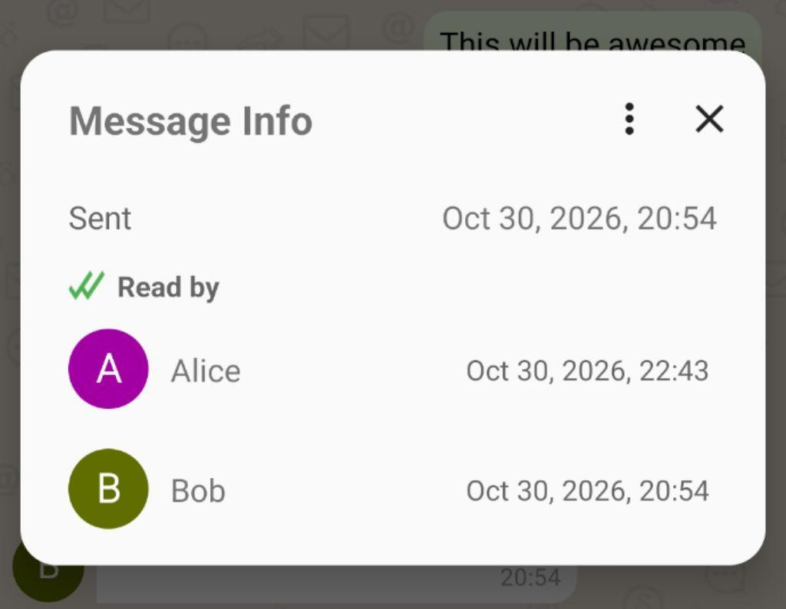

## Other noticeable improvements

Some more improvements deserving an honorable mention:

**Act on multiple messages at once:**
Multi-selecting messages and acting on them now works on all platforms,
including a long-requested implementation for Desktop.

**Mark chat as unread:**
Want to read a chat now but answer later?
The chat's context menu in the chat list now has "Mark as Unread".

**Mark profile as read:**
On the other end of the spectrum,
you can now mark a whole profile as read, on all platforms.

**Sharper images:**
To the joy of every family chat out there,
the photos you share now look noticeably sharper and keep more detail.

**New webxdc APIs:**
Mini-apps get the new experimental [`webxdc.isAppSender` and `webxdc.isBroadcast` APIs](https://webxdc.org/docs/spec/CHANGELOG.html#14---2026-04-16),
so an app can tell whether it runs for the person who shared it, or in a channel.

## Mission completed: *decentralized* instant onboarding

In 2024, we [introduced nine.testrun.org](https://delta.chat/en/2024-05-31-instant-onboarding)
as the default central instant-onboarding [relay](https://delta.chat/en/help#relays)
but then immediately engaged in 30 months of work to remove it again.
Why?
Most people go with the default choice, understandably so,
and that centralizes in practice a network that is decentralized in theory,
as happens with Matrix and the Fediverse today.

**New profiles now use multiple community relays automatically**

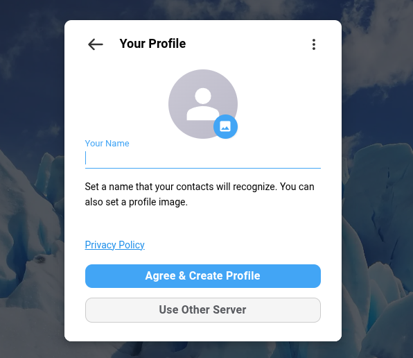
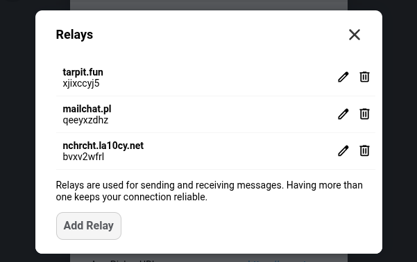

The newest Delta Chat releases offer *actual decentralization*,
which means higher resilience to server outages and network degradation,
keeping you securely chat-connected during critical times.
Moreover, the many community [chatmail relay](https://chatmail.at/doc/relay) operators
can sleep easier, knowing that their users can keep chatting
even when their server has temporary trouble.
The [revised privacy policy](https://delta.chat/en/privacy.html) linked during profile creation
is now one policy for all Delta Chat apps instead of a relay's own.
It starts from the fact that there is no directory of profiles anywhere
and gives plenty of detail, including legal information.

**You can safely remove relays you don't like or want at any time,
under "Advanced Settings -> Relays".**
Your contacts quickly and automatically learn
to stop sending messages to removed relays.
But please make sure that all your devices run app version `2.62` or later before you remove a relay.

### Resiliency unlocked: one or two relays down, but chatting continues

  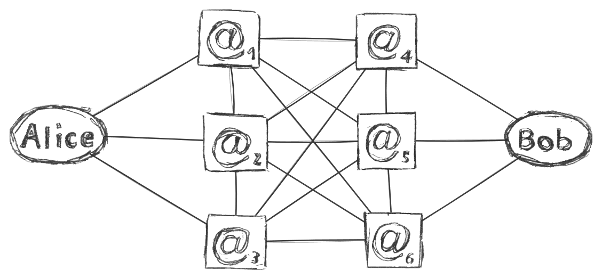

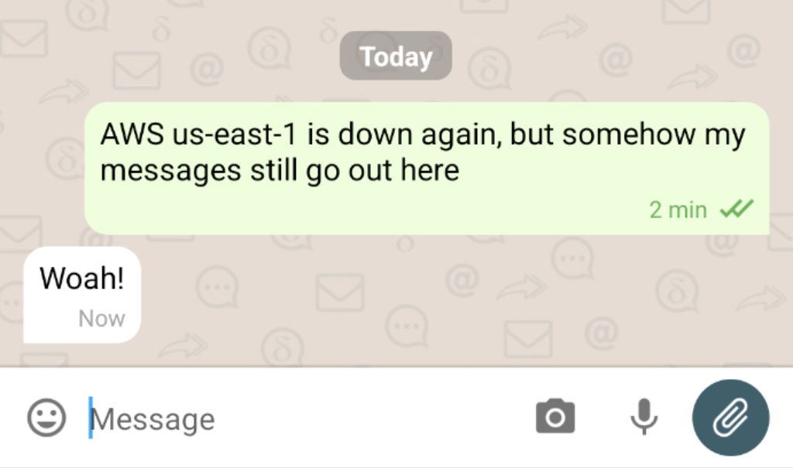
Incoming messages are fetched from all your relays,
outgoing ones go out through one relay and fall back to another if it fails,
and the connectivity view says "connected" as long as one relay is up.
A relay operator can reboot or move their machine,
and the people using it just keep chatting through their other relays :)

For the curious: details on current and upcoming multi-relay handling (tap to expand)

**How community relays are selected for new profiles.**
Just like two years ago, creating a profile asks for a name and a picture, nothing more.
But now the app pings a built-in list of community-run chatmail relays,
whose independent operators agreed to be on it,
and joins the one that answers fastest.
While you start chatting, it adds two more relays in the background
until the profile has three working relays.
Joining through a friend's invite link also adds your friend's relays to the "candidate relay set".
"Use Other Server" remains for those who want to control relay setup:
a group or organization that wants its people on particular relays
can still hand out invite links for those relays and have people create their profiles with them.
Automatic multi-relay onboarding currently applies only to newly created profiles,
but will soon also cover existing profiles whose single relay is on the public default lists.

**No relay marked "used for sending".**
When you send a message, the app picks one of your relays
and switches to another if that one fails.
We are working on sending small messages through all your relays in parallel, not just one,
to become resilient against server-to-server network problems
and against a server that accepts a message but never forwards it to the recipient's relays.

**No email address for your profile.**
Profile screens, the profile switcher and chat titles no longer show one.
A profile is identified by its encryption key
and reachable through whichever relays it currently uses.
Each relay still knows your profile by an address,
but not one you need to know or hand out.
In 2024 we said email addresses should
[recede into the background](https://delta.chat/en/2024-05-31-instant-onboarding#are-we-de-emphasizing-e-mail-addresses-in-the-user-interface),
and that is where they went.

**No green checkmark and no "introduced by" line in contact profiles.**
Since the [V2 releases](https://delta.chat/en/2025-08-04-encryption-v2),
every chat with a key-contact is end-to-end encrypted,
so the mark no longer told you anything.
Instead, contact lists and chat subtitles now hint
when a contact has not been seen for a long time.

**Immortal chat connectivity: Your contacts auto-follow your relays.**
Your encryption key carries the list of relays you can be reached at,
and your contacts send every message to all of them.
When you add or remove a relay,
a small encrypted key update message tells them automatically.
Invite links and QR codes carry all your relays,
so a new contact has the same redundancy from the start.
Removing a relay is a single step and takes effect right away on all your devices.
Only the last relay cannot be removed.
Most people should never need to touch their relay configuration,
and we aim to detect and replace broken relays automatically in the future.

## Delta Chat will soon stop supporting unencrypted email

Delta Chat is end-to-end encrypted by default,
and [chatmail relays](https://chatmail.at/relays) do not support sending or receiving unencrypted messages.
But some have used Delta Chat since the early years, when unencrypted messaging was the default.
Others switched off "Enforce Encryption" somewhere deep in the relay settings
to use Delta Chat as a somewhat convenient email client on a classic email provider or own server.
Many of our contributors have used Delta Chat this way, actually!
However, supporting unencrypted email gets in the way of explaining what Delta Chat is:
a secure and resilient decentralized messenger.

**In the next releases,
everything you send or receive will be encrypted, without exception or opt-out.**
Our reasons are much the same as those Signal gave in 2022
when it [dropped plain-text SMS support](https://signal.org/blog/sms-removal-android/):

- **Security and privacy**: unencrypted email leaks content and metadata to providers,
  which runs counter to Delta Chat's private messaging, just as unencrypted SMS ran counter to Signal's.

- **Confusing design**: with secure and insecure messages in one interface,
  people who heard "Delta Chat is secure" may be misled
  or unknowingly send insecure messages.

- **A tax on development**: handling secure and insecure messages in our
  implementation code ties up scarce developer time
  and makes the security of our code harder to reason about.

If you still use Delta Chat for unencrypted messages with classic email providers,
please move to a dedicated email app such as Thunderbird, FairEmail or K-9 Mail.
An upcoming release will
turn all unencrypted email chats read-only;
they will not receive any more messages.

## IETF-compliant and interoperable with modern email encryption

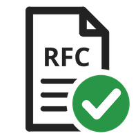

While we are dropping unencrypted email,
we **remain committed to interoperability,**
take part in IETF standardization
and implement the most recent IETF standards for encrypted email:
OpenPGP ([RFC 9580](https://www.rfc-editor.org/rfc/rfc9580)
and its predecessor [RFC 4880](https://www.rfc-editor.org/rfc/rfc4880)),
PGP/MIME ([RFC 3156](https://www.rfc-editor.org/rfc/rfc3156)),
Header Protection ([RFC 9788](https://www.rfc-editor.org/rfc/rfc9788)),
and [Autocrypt](https://autocrypt.org) for exchanging keys,
as well as the upcoming [Autocrypt v2](https://autocrypt2.org) (see the next section).
Any email app that encrypts according to these standards
remains fully interoperable with Delta Chat (and any other chatmail client).
The [full list of supported standards](https://github.com/chatmail/core/blob/main/standards.md)
is maintained within the "chatmail core" library.

## Getting ready for further security upgrades: Autocrypt v2

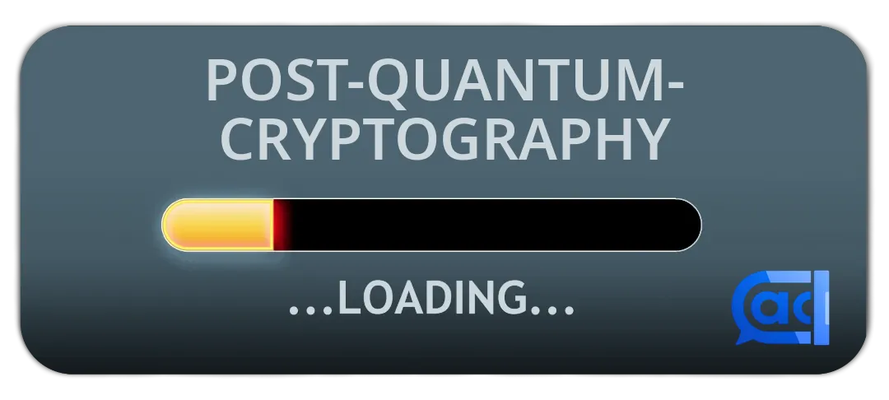
<!-- original image source: https://www.publicdomainpictures.net/en/view-image.php?image=221604&picture=future-downloading -->

Since May 2026, Delta Chat supports **Post-Quantum Cryptography (PQC)**
but does not actively send messages with it yet.
Phased rollout aims to make the transition smooth for users,
so future versions can enable PQC for sending without breaking compatibility with older releases.
This is part of our security-hardening efforts around [Autocrypt v2](https://autocrypt2.org),
which will also bring [reliable deletion](https://delta.chat/en/help#pfs),
better known as "Forward Secrecy", to Delta Chat.
Check out the [FOSDEM 2026 slides](https://autocrypt2.org/#/what-is-autocrypt-v2) for more details.

## Get the Update and join the fun

Visit [get.delta.chat](https://get.delta.chat) or your preferred store to grab the update.

If you would like to support our efforts, please consider

- [contributing or donating](https://delta.chat/en/contribute),

- [setting up a chatmail relay](https://chatmail.at/doc/relay), or

- [creating mini-apps](https://webxdc.org)

or just leave us a nice review in your app store of choice.

♥ **thanks** ♥
