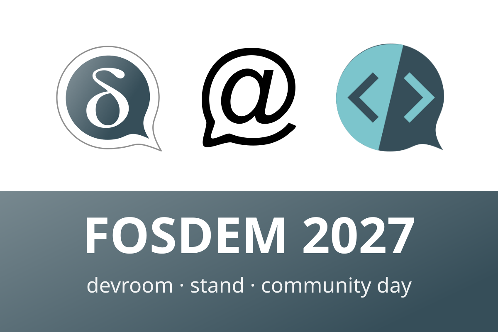

**Calling chatmail, Delta Chat and webxdc hackers and communities!**
FOSDEM happens in Brussels on 30 and 31 January 2027,
and together with our friends from [XMPP](https://xmpp.org) and [Matrix](https://matrix.org)
we are co-organizing the [Decentralised Messaging devroom on SUNDAY](https://xmpp.org/2026/10/fosdem-2027-decentralised-messaging-devroom/).

If you hack on [chatmail relays](https://chatmail.at/relays),
[the growing number of chatmail clients](https://chatmail.at/clients),
write [webxdc mini-apps](https://webxdc.org) or bots like a lunatic,
or research decentralized messaging or just use things in your communities,
please consider submitting a talk:
Share something others can learn from rather than a product pitch,
in a 25 minute slot or a 5 to 10 minute lightning talk.
**The deadline is Friday, 20 November, 23:55 UTC,**
so head over to [FOSDEM pretalx submission](https://fosdem.org/submit) soon.

**Meet us at our stand.**
We also have a confirmed Delta Chat stand at FOSDEM (location to be announced).
Expect fresh stickers and some of the people behind Delta Chat, chatmail relays and webxdc.
Drop by with your questions, ideas and bug reports,
try out mini-apps together,
or bring your phone and leave with a few new contacts,
made the way we like it best: by personally scanning each other's QR codes,
and getting to know new circles in a peer-to-peer manner.

**Save the date: Delta Chat Community Day(s) right after FOSDEM.**
The devroom has only so many slots and the FOSDEM weekend is always too short,
so starting on Monday, 1 February 2027,
we invite everyone to Delta Chat Community Day(s)
for talks, workshops and hanging out across our user and contributor communities.
Anyone who submits a talk to the devroom and does not get a slot
might just do a session on Monday instead.
Speaking of which: we have not really looked for a location yet,
so if you know a good space with room for a little crowd, with some technical and preferably also kitchen infra,
please tell us at [delta@merlinux.eu](mailto:delta@merlinux.eu)
or DM on the fediverse at [@delta@chaos.social](https://chaos.social/@delta).
More details when we have them :)
