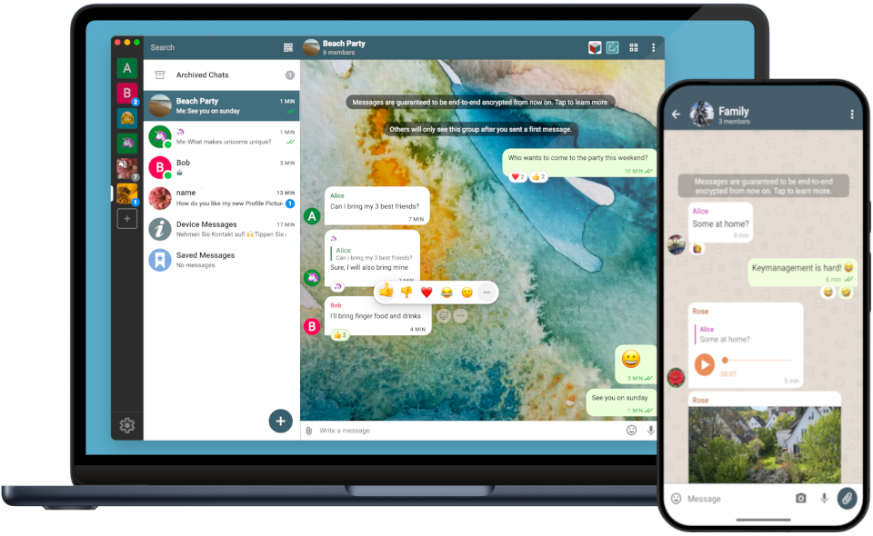

# Dezentralisierter und sicherer Messenger {#homepage-heading}

<picture>
<source srcset="../assets/home/screenshots/desktop-and-mobile-thumbnail.webp" type="image/webp" />

</picture>

<a href="https://get.delta.chat" class="download-btn">Get Delta Chat</a>

💬 Zuverlässiges Instant-Messaging mit Unterstützung für mehrere Profile und mehrere Geräte

⚡️ Bei sicheren und interoperablen [Chatmail Relays](https://chatmail.at/relays) anmelden

🥳 Interaktive [Web Apps in Chats](https://webxdc.org/) zum Spielen und für die Zusammenarbeit

🔒 [Geprüfte Ende-zu-Ende-Verschlüsselung](help#security-audits), sicher gegen Netzwerk- und Serverangriffe

👉 [F](https://en.wikipedia.org/wiki/Free_software)[OSS](https://en.wikipedia.org/wiki/Open-source_software) software, built on [Internet Standards](https://github.com/chatmail/core/blob/main/standards.md), avoiding [xkcd927](https://xkcd.com/927/) :)