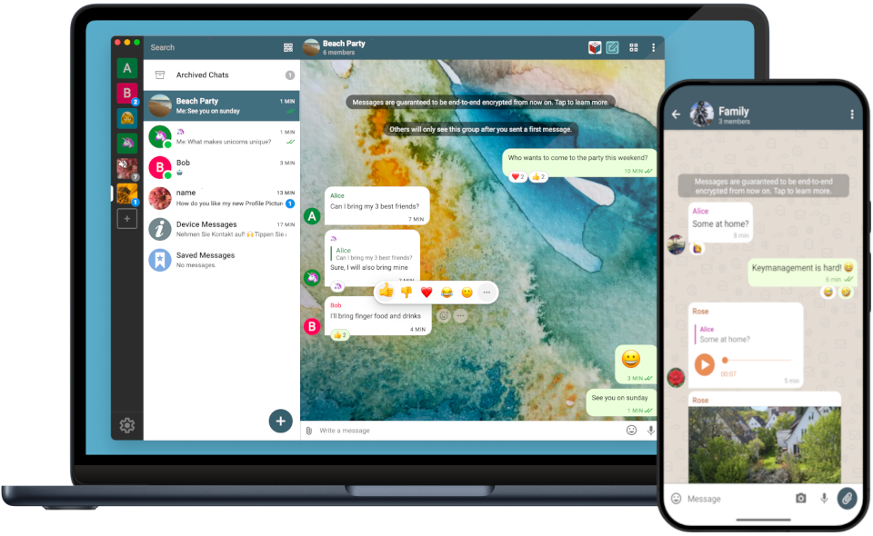

# Decentralized & Secure Messaging {#homepage-heading}

<picture>
<source srcset="../assets/home/screenshots/desktop-and-mobile-thumbnail.webp" type="image/webp" />

</picture>

<a href="https://get.delta.chat" class="download-btn">Get Delta Chat</a>

<b>No Phone Number</b>Chat without phone numbers or other private data. Create as many profiles as you like

<b>Mini Apps</b>Use in-chat Mini Apps for gaming, polls, calendars, shopping lists and more

<b>Secure</b>Video calls, audio calls and messages with audited end-to-end encryption

<b>Multi-Device</b>Pick up your conversations where you left off, on any device

<b>Sovereign &amp; Open Source</b>Keep your chats on your device, and not in someone else's cloud

<b>Decentralized</b>Experience chatting without interruptions, thanks to our decentralized architecture

