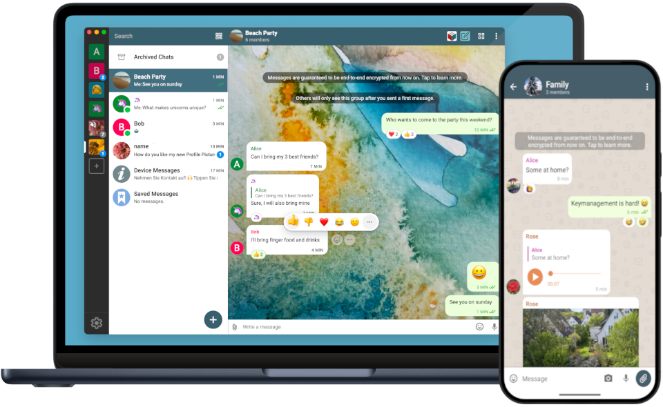

# Messagerie décentralisée et sécurisée {#accueil}

<picture>
<source srcset="../assets/home/screenshots/desktop-and-mobile-thumbnail.webp" type="image/webp" />

</picture>

<a href="https://get.delta.chat" class="download-btn">Obtenir Delta Chat</a>

💬 Une messagerie instantanée fiable avec le support de plusieurs comptes et de plusieurs appareils 

⚡️ Inscrivez-vous à des [relais chatmail](https://chatmail.at/relays) sécurisés et interopérables

🥳 [Applications web interactives dans les discussions](https://webxdc.org/) pour les jeux et la collaboration

🔒 [Chiffrement de bout-en-bout audité](help#security-audits), à l'abri contre les attaques ciblées sur le réseau ou les serveurs

👉 Logiciel [libre](https://fr.wikipedia.org/wiki/Logiciel_libre) et [Open Source](https://fr.wikipedia.org/wiki/Open_source), basé sur des [Standards d'Internet](https://github.com/deltachat/deltachat-core-rust/blob/master/standards.md), évitant [xkcd927](https://xkcd.com/927/) :)